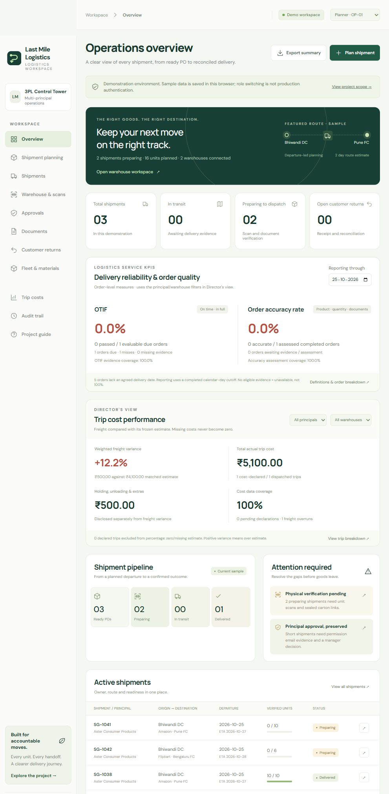

# Last Mile Logistics — 3PL Logistics Control Tower

A working, responsive logistics-execution demonstration for MBA interview discussion. The principal owns the goods; the 3PL executes bulk warehouse and delivery work under a contract. Amazon/Flipkart appear as receiving customers in the sample scenario.

**Status:** functional browser-local demonstration. Not a production warehouse management system, hosted deployment or independently verified company case study. All sample entities, rates, documents and events are synthetic.

## Run

Requires Node.js 22 or later. No packages or API keys are required.

```text
node server.mjs
```

Open http://127.0.0.1:4173 in your browser. On Windows you can use **Start Last Mile Logistics.cmd**, then open the displayed address. Keep the window running while using the project. To stop, press Ctrl+C in that window. Do not open index.html directly: browsers require HTTP for module loading.

## Validate

```text
node --test tests/*.test.mjs
node --check dist/engine.mjs
node --check dist/app.mjs
```

## What works

- Multi-principal, multi-warehouse synthetic records and stock ownership.
- Order-level OTIF and order accuracy KPIs with a reporting cutoff, evidence coverage, customer commitments and delivery assessment.
- Approved PO ready balances, compatibility checks and multi-order grouping.
- Principal/route-specific sample rates, weight/volume fit, utilization warnings and separately calculated ETA.
- Departure-date appointment, warehouse assignment and manual transporter details.
- Registered serialized product identities; wrong/duplicate/excess scan rejection; carton/pallet aggregation without double counting.
- Quantity changes, partial-dispatch requests, attached principal permission evidence and current-version manager approval.
- Scanner incident, independent checker reconciliation and manager-approved manual quantity verification.
- Small retrievable local documents, explicit synthetic evidence generation, review and quantity checks.
- Dispatch gates, single stock issue per shipment, allocation release and source-linked stock movements.
- POD and accepted/returned quantity reconciliation, actual trip costs and comparable freight variance.
- Customer-return inspection, usable-stock restoration, damaged/missing disclosure, draft credit/debit-note preparation, internal approval, printable HTML download, reconciliation and closure.
- Editable truck types and packed material dimensions with automatic volume conversion, master revisions and affected-load review.
- Director overview with weighted freight variance, actual trip cost, extra charges, coverage, principal/warehouse filters and drilldown.
- Editable transporter template draft/download, CSV summary, JSON state/audit exports, reset and built-in interview guide.

## Demonstration roles

Use the top-right selector: Planner, Warehouse, Checker, Manager, Accounts. The workflow engine rejects commands issued under an unsuitable simulated role. **This selector is not authentication**; it is an educational way to demonstrate separation of duties. The browser owner can inspect or edit all data.

## Scope decisions

Approved POs and allocated stock are inputs. Procurement, vendor returns, full accounting, actual financial payments, live marketplaces, carrier booking, government-document issuance, GPS/RFID and automated external sends are excluded. The 3PL prepares financial documents under the agreed business model; this demonstration prepares printable drafts and stores explicit issuer/reconciliation references, not legally issued notes.

The appointment is planned warehouse departure. ETA is a separate configured route estimate, not a customer slot or live traffic prediction. Partial dispatch needs principal permission email evidence plus manager approval. Loss liability remains contract-specific; it is not automatically assigned to the 3PL by software.

## Data and limitations

State, file content and audit events are stored in this browser's localStorage. Small files share the browser quota; keep total attachments modest. Clearing browser storage removes records; export first. This is single-device sample software, without concurrent-user transaction guarantees, server access control, private shared storage or tamper-proof audit. Synthetic sample evidence can intentionally satisfy demo gates but never proves a real transaction.

Registered sample product codes are LED-U-0001…0080, FAN-U-0001…0030 and KET-U-0001…0060. They are demonstration identifiers, not GS1 allocations or manufacturer-issued serials. The scan field accepts keyboard-wedge scanner input; physical scanner/camera connectivity was not tested. One carton/pallet aggregation level is supported. Mixed-SKU customer returns require future line-level delivery reconciliation; use single-SKU demonstration shipments.

Optional server-side OpenAI assistance is implemented for shipment explanations, transporter drafts and document-gap summaries. The local credential is configured, but the live smoke test on 26 October 2026 returned insufficient_quota; successful live generation is not verified. The labeled local fallback works without an API key. See docs/AI_COPILOT.md. Rule checks and arithmetic are not machine learning or reinforcement learning. Read docs/ARCHITECTURE_AND_ROADMAP.md before claiming production readiness or AI capabilities.

## Where to begin

1. Open Project guide → Guided walkthrough.
2. Read docs/DEMO_AND_INTERVIEW_GUIDE.md.
3. Read docs/REQUIREMENTS_AND_DECISIONS.md for confirmed versus proposed rules.
4. Read docs/QA_REPORT.md for verified behavior and limitations.

Project source: dist/engine.mjs contains the pure workflow logic; dist/app.mjs renders the interface; dist/styles.css defines the visual system; server.mjs serves local assets and the optional AI gateway; tests/ contains business-invariant tests.

Source is maintained on GitHub. Website hosting is separate; the Node server is required for optional live AI. The included sample data is synthetic.

## Interface preview



## Service KPI guide

See docs/LOGISTICS_KPIS.md for OTIF and order-accuracy definitions, reporting cutoff, evidence coverage, agreed-date capture and delivery assessment. The dashboard does not fabricate percentages for missing evidence.
